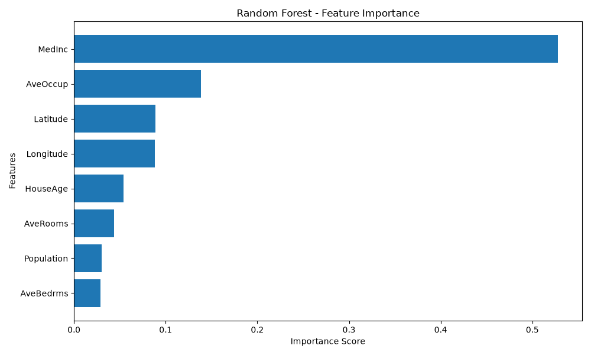
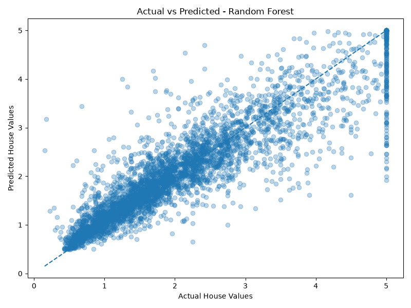

# 🏠 House Price Prediction

A beginner-friendly Machine Learning project that predicts median house values in California using regression algorithms.

## 📌 Project Overview

The goal of this project is to build and evaluate machine learning models for predicting house prices based on different housing and geographical features.

The project uses the **California Housing dataset** provided by Scikit-learn. 

Three regression approaches are implemented and compared:

* Mean Baseline
* Linear Regression
* Random Forest Regressor

## 🛠️ Technologies & Libraries

* Python
* NumPy
* Pandas
* Matplotlib
* Scikit-learn
* Jupyter Notebook

## 📂 Project Structure

```text
house-price-prediction/
│
├── notebooks/
│   └── house_price_prediction.ipynb
│
├── src/
│   └── train.py
│
├── actual_vs_predicted.png
├── feature_importance.png
├── requirements.txt
├── .gitignore
└── README.md
```

## 📊 Dataset Features

The dataset contains the following input features:

| Feature    | Description                      |
| ---------- | -------------------------------- |
| MedInc     | Median income in the block group |
| HouseAge   | Median house age                 |
| AveRooms   | Average number of rooms          |
| AveBedrms  | Average number of bedrooms       |
| Population | Block group population           |
| AveOccup   | Average household occupancy      |
| Latitude   | Geographic latitude              |
| Longitude  | Geographic longitude             |

**Target:** Median house value.

## 🤖 Models & Evaluation

The models were evaluated using three regression metrics:

* **MAE** — Mean Absolute Error
* **RMSE** — Root Mean Squared Error
* **R²** — Coefficient of Determination

### Model Performance

| Model             |       MAE |      RMSE |        R² |
| ----------------- | --------: | --------: | --------: |
| Mean Baseline     |     0.906 |     1.145 |    -0.000 |
| Linear Regression |     0.533 |     0.746 |     0.576 |
| Random Forest     | **0.328** | **0.507** | **0.804** |

Random Forest achieved the best performance among the three models, with an R² score of **0.804**.

## 📈 Visualizations

### Feature Importance

This chart shows the relative importance of input features according to the Random Forest model.



### Actual vs Predicted

This visualization compares actual house values with the values predicted by the Random Forest model.



## ⚙️ Installation & Usage

### 1. Clone the repository

```bash
git clone https://github.com/sardorbekmuminov/house-price-prediction.git
cd house-price-prediction
```

### 2. Create a virtual environment

```bash
python -m venv .venv
```

Activate it:

**Windows (Git Bash):**

```bash
source .venv/Scripts/activate
```

**Windows (Command Prompt):**

```bash
.venv\Scripts\activate
```

### 3. Install dependencies

```bash
pip install -r requirements.txt
```

### 4. Run the project

```bash
python src/train.py
```

You can also explore the analysis in:

`notebooks/house_price_prediction.ipynb`

## 🎯 Key Learnings

Through this project, I practiced:

* Data preprocessing and exploration.
* Training regression models.
* Comparing machine learning algorithms.
* Evaluating model performance using regression metrics.
* Visualizing feature importance and prediction results.
* Organizing and publishing a Machine Learning project on GitHub.

## 🚀 Future Improvements

* Hyperparameter tuning.
* Cross-validation.
* Experimenting with additional regression algorithms.
* Improving model performance.
* Saving and loading trained models.

## 👨‍💻 Author

**Sardorbek Muminov**

* GitHub: [@sardorbekmuminov](https://github.com/sardorbekmuminov)

---

*This project was developed as part of my journey in learning Machine Learning and building practical projects.*
